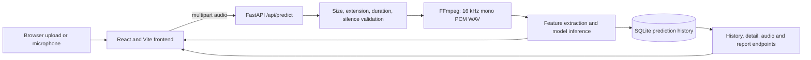
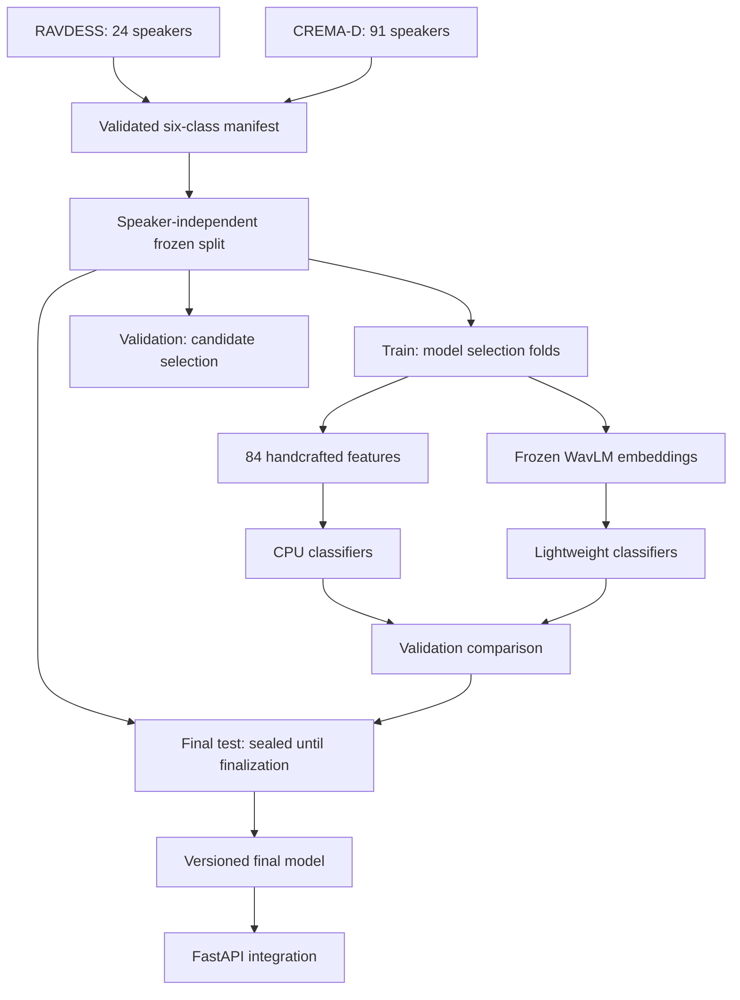

# SpeechSense Architecture

## Runtime flow

The frontend never creates predictions. Every displayed emotion score originates
from the backend model response and is stored with the corresponding prediction.

## Current deployment

`backend/predictor.py` loads the historical artifacts from `models/final_model/`
once per process. It extracts 84 values in a fixed order: 40 MFCC means, 40 MFCC
standard deviations, RMS mean and standard deviation, and zero-crossing-rate mean
and standard deviation. A calibrated SVM and HistGradientBoosting classifier are
combined with equal-weight probability averaging.

The historical classifier supports eight RAVDESS labels. It remains available as
the rollback model until a stronger six-class candidate completes validation,
final-test evaluation, and integration testing.

## Phase 2 experiment architecture

Dataset-prefixed speaker identifiers prevent collisions between corpora. Exact
PCM hashes detect duplicates. All learned preprocessing, SVM calibration, and
classifier fitting occur within training speakers; validation and test speakers
are excluded from those fit operations.

## Persistence

SQLite stores prediction IDs, filenames, emotion results, serialized score maps,
duration, input size, stored-audio reference, and timestamp. Phase 2 integration
will add model-version and processing-time fields through a backward-compatible
migration so historical predictions remain readable.

## Artifact safety

Datasets, virtual environments, uploaded audio, databases, feature caches,
embeddings, and binary model files are excluded from Git. Source, small reports,
manifests, configuration, and evaluation summaries are tracked. The original
eight-class artifacts are preserved under `models/final_model/`.
