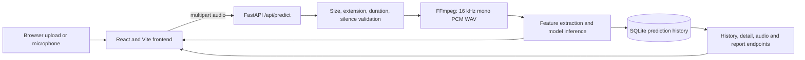
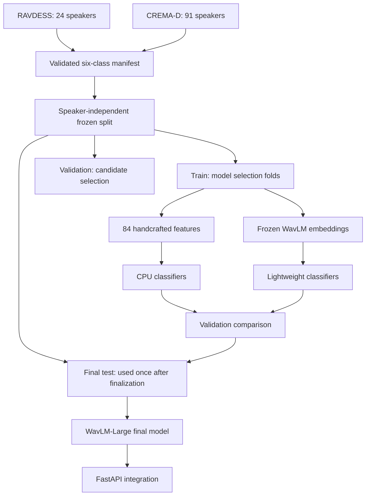

# SpeechSense Architecture

## Runtime flow

The frontend never creates predictions. Every displayed emotion score originates
from the backend model response and is stored with the corresponding prediction.

## Current deployment

`models/deployment.json` selects a versioned backend path. Phase 2 WavLM-Large
is active. The historical path loads the preserved eight-class artifacts from
`models/final_model/` and keeps the 84-feature soft-voting ensemble available
for immediate rollback.

The Phase 2 path loads WavLM-Large once, mean-pools its masked hidden states, and
passes the 1,024-value embedding to the validated six-class Logistic Regression
artifact. The classifier is stored as a small, version-independent NumPy
artifact containing the fitted imputer, scaler, coefficients, intercepts, and
class order. This avoids scikit-learn pickle compatibility problems between the
Colab training environment and Windows. The backend verifies dimensions,
finite values, label order, and probability order at startup. The frontend
reads `/api/health` and displays the active model family.

## Phase 2 experiment architecture

Dataset-prefixed speaker identifiers prevent collisions between corpora. Exact
PCM hashes detect duplicates. All learned preprocessing, SVM calibration, and
classifier fitting occur within training speakers; validation and test speakers
are excluded from those fit operations.

## Persistence

SQLite stores prediction IDs, filenames, emotion results, serialized score maps,
duration, input size, stored-audio reference, timestamp, model version,
processing time, and an uncertainty flag. It also supplies live Overview totals,
recent activity, average duration, and emotion distribution. A backward-compatible
startup migration keeps historical predictions readable. The API supports bulk
history removal and per-entry removal of both the row and stored WAV.

## Artifact safety

Datasets, virtual environments, uploaded audio, databases, feature caches,
embeddings, and large or pickle-based model files are excluded from Git. Source,
small reports, manifests, configuration, evaluation summaries, and the 69 KB
portable Phase 2 classifier are tracked. The original eight-class artifacts are
preserved under `models/final_model/`.
